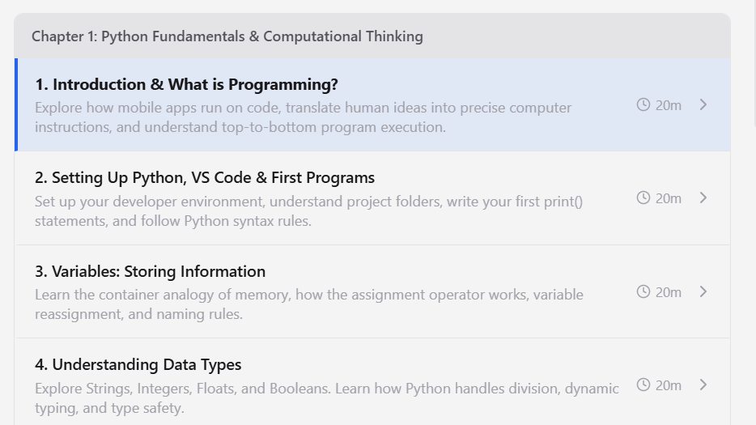
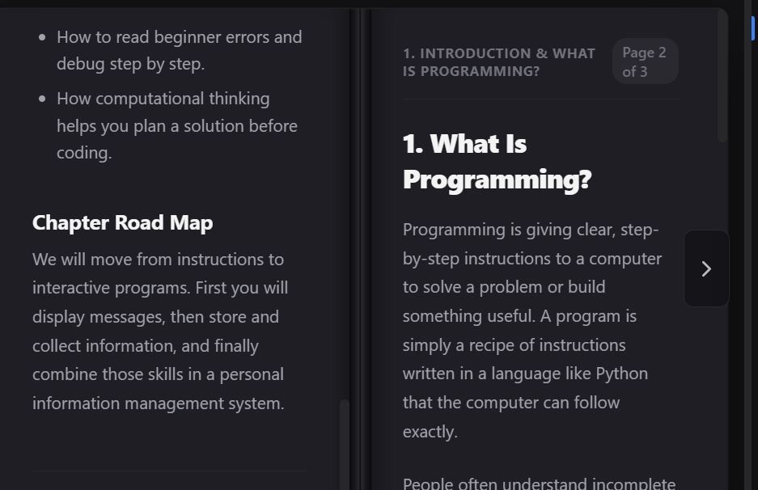
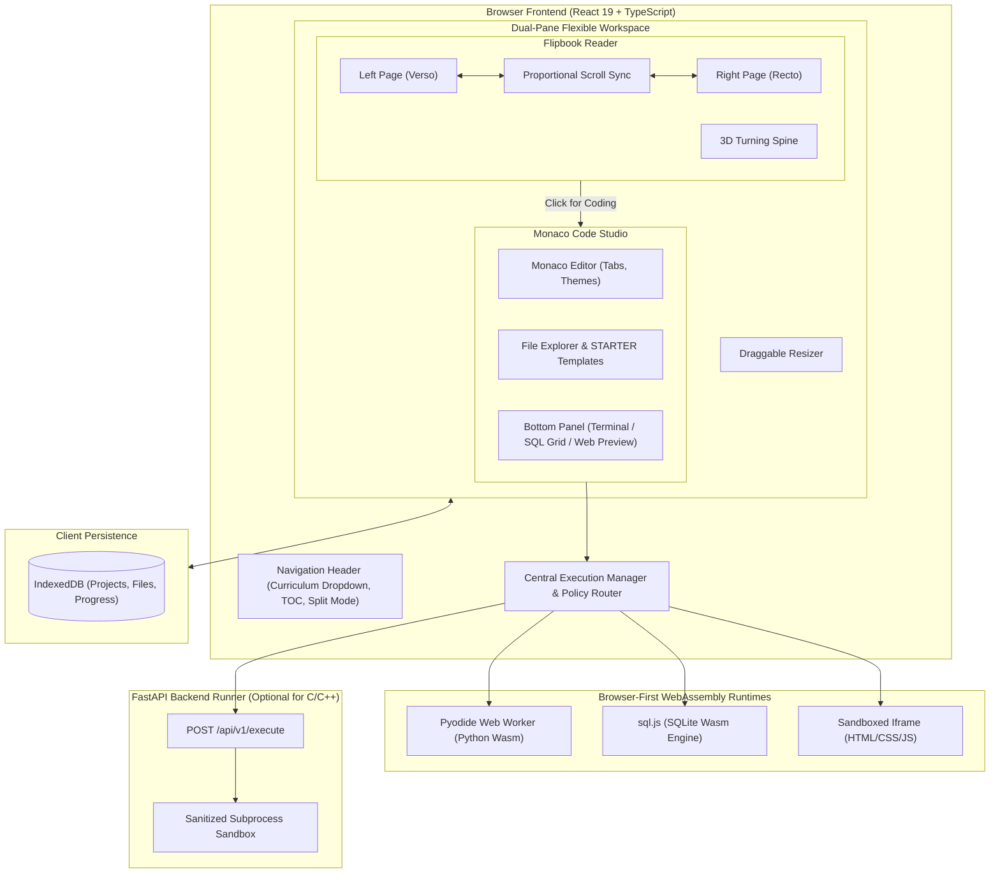

<p align="center">
  
</p>

<p align="center">
  <strong>Interactive Dual-Pane Learning Platform &amp; Browser-First Multi-Language IDE</strong>
</p>

<p align="center">
  <a href="LICENSE"></a>
  <a href="https://www.typescriptlang.org/"></a>
  <a href="https://react.dev/"></a>
  <a href="https://fastapi.tiangolo.com/"></a>
  <a href="https://pyodide.org/"></a>
  <a href="https://sqlite.org/"></a>
</p>

---

## 💡 About NovaPad

**NovaPad** is a modern interactive learning platform and multi-language web IDE designed to eliminate the cognitive friction between reading educational theory and executing practical code.

In traditional programming education, students are constantly forced to switch between static PDF textbooks, separate browser tabs, and complex local IDE installations. **NovaPad bridges this gap** into a unified, dual-pane workspace:

```text
STUDENT
   │
   ▼
Interactive 3D Flipbook (Read concepts & review diagrams)
   │
   ▼
"Click for Coding" (Contextual lab launcher)
   │
   ▼
Side-by-Side Workspace (Book on Left, IDE on Right)
   │
   ▼
Instant Browser Execution (Python, SQLite, Web, C/C++)
   │
   ▼
Live Output, Tabular Results & Direct Feedback
```

---

## ✨ Key Features

### 📖 Authentic 3D Flipbook Reader
- **Two-Page Open Book Spread**: Renders an authentic two-page open book (Verso on left, Recto on right) with realistic paper spine crease and stacked page edge trims.
- **Bidirectional Lockstep Scroll Synchronization**: When scrolling either page, dragging a scrollbar, or rolling the mouse wheel across the book spine, both sides scroll in perfect proportional synchronization.
- **3D Page Turn Physics & Sound**: Realistic page-flip transitions powered by GPU-accelerated CSS 3D transforms (`rotateY`) with optional Web Audio sound effects.
- **High-Visibility Typography System**: Three custom themes (High-Contrast Modern Dark, Authentic Paper, Warm Reading Sepia), three font scaling tiers (Normal 16.5px, Large 19px, X-Large 22px), and serif/sans font toggles.
- **Pedagogical Callouts**: In-page highlighted callout blocks for *Key Takeaways*, *Try It Yourself*, *Good Programming Habits*, *Watch Out warnings*, and *Level-Up Challenges*.
- **Interactive Code Blocks**: Copyable inline code chips and syntax-highlighted code snippets with a 1-click **"Insert into IDE"** shortcut.
- **Curriculum Navigator**: Jump instantly across textbook sections using the topic dropdown or the interactive Table of Contents modal.

### ⚡ Browser-First Multi-Language IDE
- **Zero-Install Client-Side Python**: Runs full Python scripts entirely inside the browser using **Pyodide WebAssembly** in a dedicated background Web Worker, ensuring an unblocked UI and live streaming stdout/stderr.
- **Relational SQL Database**: Powered by **sql.js WebAssembly**, enabling students to write SQLite queries, execute multi-statement DDL/DML, and visualize structured tabular result grids with CSV export.
- **Sandboxed Web Playground**: Real-time HTML, CSS, and JavaScript preview inside a secure, null-origin `<iframe>` with bidirectional console capture bridge.
- **Server C/C++ Execution**: Automated compiler toolchain discovery (GCC/Clang) via a secure FastAPI backend sandbox with compiler diagnostic capture and process isolation.
- **Central Execution Manager**: Intelligent language router, request validation, cooperative/preemptive worker cancellation, and automated infinite-loop timeouts.
- **Offline Persistence & Portability**: Automatically saves files, project state, and reading progress into browser IndexedDB (`idb`), with full ZIP project export/import support.

---

## 📸 Screenshots Showcase

<p align="center">
  
  <br />
  <em>Figure 1: Authentic Two-Page Flipbook Reader with synchronized dual-page scrolling, section dropdown, and copyable code examples.</em>
</p>

<p align="center">
  
  <br />
  <em>Figure 2: Contextual Side-by-Side workspace showing the Flipbook on the left and the active Monaco Code Editor on the right.</em>
</p>

---

## 🛠️ Technology Stack

| Domain | Technology | Purpose |
|---|---|---|
| **Frontend Framework** | React 19 + TypeScript | High-performance reactive UI with modern hooks |
| **Build Tooling** | Vite 8 + Rolldown | Blazing-fast development server & optimized production bundling |
| **Code Editor** | Monaco Editor (`@monaco-editor/react`) | Industry-standard IDE editor with syntax highlighting & auto-closing |
| **Python Runtime** | Pyodide WebAssembly | In-browser Python 3 execution in a dedicated Web Worker |
| **SQL Engine** | sql.js (SQLite Wasm) | In-memory relational database engine with table grid visualizations |
| **Web Preview** | Sandboxed Iframe (`allow-scripts`) | Isolated HTML/CSS/JS preview with safe console bridge |
| **Backend Service** | FastAPI + Uvicorn (Python 3.10+) | Isolated subprocess sandbox runner for C/C++ compilation |
| **Storage & State** | IndexedDB (`idb`) + JSZip | Client-side persistent storage and full project ZIP export/import |
| **Testing** | Vitest + Pytest | Comprehensive unit test suites for frontend and backend |
| **Styling & Icons** | Vanilla CSS Tokens + Lucide Icons | Clean, responsive design without runtime CSS bloat |

---

## 🏗️ System Architecture



---

## 🚀 Quick Start Guide

### Prerequisites
- **Node.js**: v18.0.0 or higher (v20+ recommended)
- **npm**: v9.0.0 or higher
- **Python**: 3.10 or higher (required for optional backend runner)

---

### 1. Clone the Repository
```bash
git clone https://github.com/your-username/novapad.git
cd novapad
```

---

### 2. Start the Frontend (Vite)
```bash
cd frontend
npm install
npm run dev
```
Open **`http://localhost:5173`** in your browser.

> [!TIP]
> The browser-first runtimes (**Python via Pyodide**, **SQLite via sql.js**, and **HTML/CSS/JS**) run immediately without requiring the backend server to be active.

---

### 3. Start the Backend Runner (FastAPI — Optional for C/C++)

For server-side C/C++ compilation and backend execution:

#### Windows (PowerShell):
```powershell
# From repository root
python -m venv venv
.\venv\Scripts\activate
pip install -r backend/requirements.txt

$env:PYTHONPATH = "backend"
python -m uvicorn app.main:app --host 127.0.0.1 --port 8000 --reload
```

#### macOS / Linux:
```bash
# From repository root
python3 -m venv venv
source venv/bin/activate
pip install -r backend/requirements.txt

export PYTHONPATH="backend"
python3 -m uvicorn app.main:app --host 127.0.0.1 --port 8000 --reload
```

Backend health status is accessible at `http://127.0.0.1:8000/health`.

#### Docker Alternative:
```bash
cd infra
docker compose up --build
```

---

## 🧪 Verification & Testing

NovaPad includes comprehensive automated tests covering both frontend execution adapters and backend subprocess isolation:

### Frontend Unit Tests (Vitest)
```bash
cd frontend
npm test
```
*Tests cover the Execution Manager, Web Adapter, Runtime Registry resolution, and the Spread Synchronized Scrolling algorithm.*

### Frontend Production Build Verification
```bash
cd frontend
npm run build
```

### Backend Test Suite (Pytest)
```bash
# In repository root with virtual environment activated
# Windows PowerShell:
$env:PYTHONPATH = "backend"
pytest backend/tests -v

# macOS / Linux:
export PYTHONPATH="backend"
pytest backend/tests -v
```

---

## 📚 Technical Documentation

Explore the in-depth documentation in the [`docs/`](docs/) directory:

- 📐 [**Architecture & System Design**](docs/architecture.md): Deep-dive into state machines, synchronization math, and runtime contracts.
- 💻 [**Development Guide**](docs/development.md): Local workflows, debugging tips, and codebase organization.
- 🔌 [**REST API Reference**](docs/api.md): Detailed specifications for backend execution endpoints and JSON schemas.
- 📊 [**Runtime Capabilities Matrix**](docs/runtime-matrix.md): Execution boundaries, timeout policies, and sandbox details.
- 🔒 [**Security Architecture**](docs/security.md): Multi-tier isolation model across browser workers, iframes, and subprocesses.
- 🛠️ [**Troubleshooting & FAQ**](docs/troubleshooting.md): Solutions for Pyodide CDN caching, compiler paths, and environment settings.

---

## 🤝 Contributing

Contributions are welcome! Please read [CONTRIBUTING.md](CONTRIBUTING.md) for development guidelines, coding conventions, and pull request procedures.

---

## 🛡️ Security

Please review our [SECURITY.md](SECURITY.md) for details on our vulnerability disclosure process and security boundaries.

---

## 📄 License

This project is licensed under the [MIT License](LICENSE).
