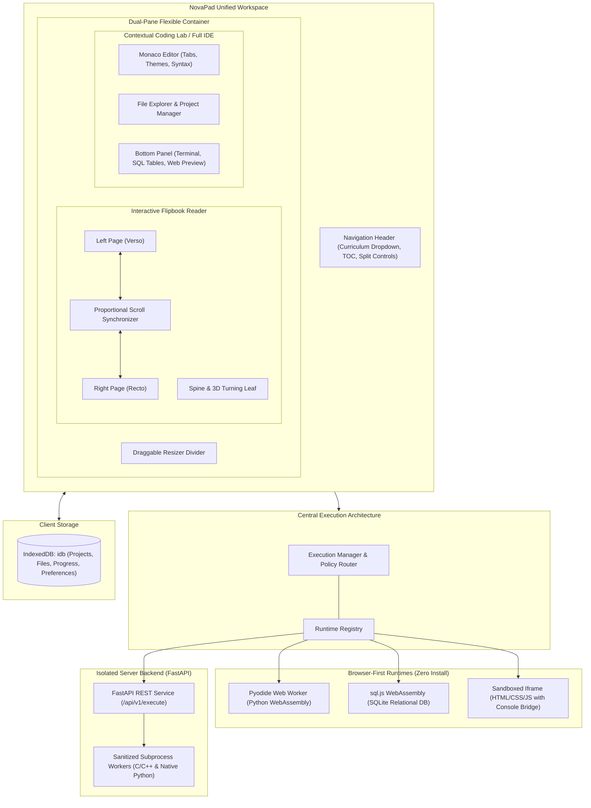

# NovaPad Architecture & System Design

NovaPad is an interactive dual-pane learning environment and multi-language web IDE designed to eliminate the cognitive barrier between conceptual reading and hands-on coding.

---

## 1. System Overview



---

## 2. Core Architectural Pillars

### A. The Interactive Flipbook Engine

The Flipbook is not a static PDF embed or a generic markdown scrollview. It is a purpose-built, dual-page book reading component with realistic tactile physics:

1. **Dual-Page Spread Layout**:
   - Renders authentic two-page spreads (Verso on the left, Recto on the right) with a simulated center book crease and outer page trim gutters.
   - Automatically collapses into a single-page view when the workspace transitions to Side-by-Side (Split) mode or narrow viewports.

2. **Bidirectional Lockstep Scroll Synchronization**:
   - Pages in a spread can contain varying amounts of content (e.g., text explanations on the left vs. diagrams and code blocks on the right).
   - NovaPad computes a proportional scroll ratio:
     $$\text{ratio} = \frac{\text{scrollTop}}{\text{scrollHeight} - \text{clientHeight}}$$
   - When the user scrolls either page, drags a scrollbar, or rolls their mouse wheel across the center spine, both pages advance in lockstep.
   - Circular scroll event loops are eliminated using a synchronization lock flag and `requestAnimationFrame`.

3. **3D Page Turn Animation & Sound**:
   - Page flips trigger a GPU-accelerated CSS 3D rotation (`rotateY(-180deg)`) using `transform-style: preserve-3d` and dynamic lighting drop shadows.
   - Optional Web Audio API synthesis produces a subtle paper-turn sound effect.

4. **Pedagogical Callouts & Actionable Code Chips**:
   - In-page callouts (`Key Takeaways`, `Try It Yourself`, `Good Habits`, `Watch Out`, `Challenge`) are highlighted with distinct visual accents.
   - All inline code snippets and code examples feature interactive copy chips and an "Insert into Active Editor" button.

---

### B. Contextual Coding Launcher ("Click for Coding")

NovaPad solves the educational disconnect where students are forced to manually configure an external editor:

```
Flipbook Lesson
      │
      ▼
Lesson Page Metadata
      │
      ▼
CodingActivityConfig { mode: "text", language: "python", starterFiles: [...] }
      │
      ▼
launchCodingActivity()
      │
      ├─► Find or instantiate lesson project in IndexedDB
      ├─► Populate starter files without overwriting user progress
      ├─► Switch workspace to Side-by-Side (Split) mode
      └─► Mount active file into Monaco Editor with appropriate runtime
```

---

### C. Central Execution Manager & Runtime Registry

The `ExecutionManager` acts as the single source of truth for all code execution requests:

```typescript
interface ExecutionRequest {
  requestId: string;
  language: string;
  source: string;
  activeFile: string;
  files: Record<string, string>;
  timeoutSeconds?: number;
}
```

1. **Intelligent Routing**:
   - `.py` files route to the browser `PythonRuntimeAdapter` (Pyodide Web Worker).
   - `.sql` files route to the browser `SqlRuntimeAdapter` (sql.js).
   - `.html`, `.css`, `.js` files route to the `WebRuntimeAdapter` (Sandboxed iframe).
   - `.c`, `.cpp` files route to the `RemoteBackendAdapter` (FastAPI backend).

2. **Contract Normalization**:
   - All runtimes normalize their output into a unified `ExecutionResult` payload containing `stdout`, `stderr`, `exitCode`, `duration`, `status` (`success` | `error` | `timed_out` | `cancelled`), and optional `structuredResults` (for SQL tabular results).

3. **Preemption & Timeout Handling**:
   - Tracks active request IDs to prevent out-of-order race conditions from delayed completions.
   - Implements automated timeouts: if client-side Python execution exceeds the allotted duration (default: 10s), the background Web Worker is forcefully terminated via `worker.terminate()`, instantly freeing browser threads and preventing UI freezes.

---

### D. Security Boundaries

1. **Client Isolation**:
   - Pyodide Web Worker runs in a dedicated thread without access to `window.document` or local storage.
   - Web Playground runs in `<iframe sandbox="allow-scripts">` without `allow-same-origin`, assigning it an opaque `null` origin.
2. **Server Sandboxing**:
   - Subprocesses are spawned with `shell=False` in ephemeral directories.
   - Host secrets and ambient environment variables are stripped prior to execution.
   - Execution time, output buffers, and memory are constrained.
